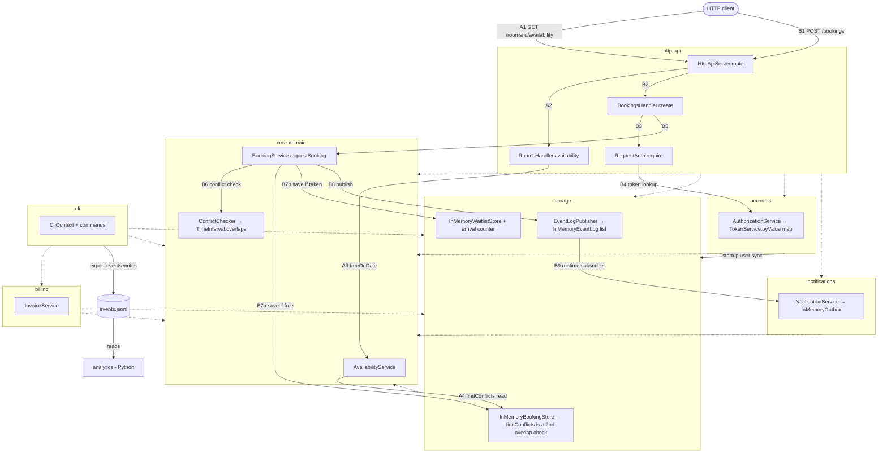

# BOUNDARIES.md

One section per milestone. Fill them in in order (the sketch before you write
anything about it, the copies next, the proposal last).

Draw Milestone 1's sketch from the code. A TA may ask where each arrow came
from.

Keep it short and specific. Point at modules, files, and callers.

---

## Milestone 1: The architecture as built

**The sketch.** Draw the modules, what each one writes, and the path an
availability request and a booking request each take from the entry point to
storage. Any form works (a Mermaid diagram in this file, or a photo of paper
kept beside it or linked here).

One page. The sketch is done when someone could use it to predict which module
a given change goes in.

Dotted arrows are compile-time dependencies (imports). Solid arrows labelled
**A#** are the availability path and **B#** the booking path.



What each module writes, all of it in process memory:

- `storage`: bookings, waitlist rows, rooms and users (`InMemoryRecordStore.java:24`),
  and events (`InMemoryEventLog.java:26`).
- `core-domain`: decides every booking and waitlist write (`BookingService.java:124, 332`)
  but holds no data of its own.
- `accounts`: accounts (`AccountDirectory.java:24`) and tokens (`TokenService.java:31`),
  and it copies users into storage once at startup (`AccountDirectory.java:174`).
- `notifications`: queued messages (`InMemoryOutbox.java:28`).
- `cli`: `events.jsonl`, through `export-events` (`ExportEventsCommand.java:49`).

Evidence for the dotted arrows: each module's `pom.xml`, plus
`grep -rhoE '^import edu\.cmu\.cs214\.campusreserve\.[a-z]+' <module>/src/main | sort | uniq -c`.
The module-level arrows match `ARCHITECTURE.md` exactly.

**Where your sketch and `ARCHITECTURE.md` disagree.** List at least two
places where your drawing and the repository's drawing are not the same
picture, each in one line. Include things you drew that it does not, and things it draws
that you did not.

1. **Availability.** `ARCHITECTURE.md:85` and `AGENTS.md:45-46` say `TimeInterval.overlaps` is the only overlap
   check and availability uses it. In the code, availability uses a second, hand-written check in
   `InMemoryBookingStore.findConflicts` (`InMemoryBookingStore.java:61-62`).
2. **Event log.** `ARCHITECTURE.md:136, 194-196` says the event log outlives a process through
   `JsonlFileEventLogWriter`. In the code, both entry points use `StoreRegistry.inMemory()`, so the
   server's events are lost when it stops.
3. **BookCommand.** `ARCHITECTURE.md:77` names a `BookCommand`. In the code the class is
   `BookingCommands.Book` (`BookingCommands.java:33`).
4. **Drawn here, missing from the doc: the user sync.** `accounts` copies users into storage's user
   store once at startup (`AccountDirectory.java:174-181`, called at `CampusReserveServer.java:54`).
5. **Drawn here, missing from the doc: the subscriber link.** `storage` calls `notifications` at
   runtime through the `EventPublisher` interface, wired at `CampusReservePlatform.java:58`.
6. **Drawn here, missing from the doc: shared JSON escaping.** `http-api` builds its HTTP responses
   with the event log's JSON escaper (`JsonObject.java:3, 96`).

**How you decided which one is right.** For each disagreement above, name the
check that settled it (the imports you read, the callers you listed, the wiring
you traced, the test that pins the behavior). "It looked that way" is not a
check, and neither is "the document says so". Your agent may produce the trace,
but check it before you rely on it.

1. **Callers listed.**
   - `grep -rn '\.overlaps(' --include=*.java */src/main` finds calls only in `ConflictChecker.java`.
   - `grep -rln ConflictChecker --include=*.java */src/main` shows `AvailabilityService` never uses it.
   - `grep -rn findConflicts --include=*.java */src/main` shows `AvailabilityService.java:35, 41`
     calling the storage version.
   - Pinning test: storage's `FindConflictsTest`. Core's `AvailabilityServiceTest` uses a fake store
     (`InMemoryStores.java:109-112`) that does call `overlaps`, so it never runs the real check.
2. **Wiring traced.**
   - `grep -rnE 'withEventLogFile|new JsonlFileEventLogWriter|StoreRegistry\.(inMemory|with)\(' --include=*.java */src/main`
     shows `StoreRegistry.inMemory()` at `CampusReservePlatform.java:44` and `CliContext.java:54`.
   - The same grep finds no production caller of `withEventLogFile`.
   - The writer itself works (`EventLogTest.appendsOneLinePerEvent`); it just isn't wired in.
3. **Grep.** `grep -rn BookCommand --include=*.java .` finds nothing.
4. **Callers listed.** `grep -rn syncInto --include=*.java */src/main` leads to
   `CampusReservePlatform.java:144`, which `CampusReserveServer.java:54` calls once at startup.
5. **Wiring traced.** `CampusReservePlatform.java:58` (`stores.subscribe(notifications)`) feeds
   `EventLogPublisher.java:41` (`subscriber.publish`). Storage has no import of notifications.
6. **Import read.** `http-api/.../JsonObject.java:3` has `import edu.cmu.cs214.campusreserve.storage.JsonLine;`.

---

## Milestone 2: Run it as copies

**Your stack.** The command that brought the stack up with two copies, and how
many distinct `X-Upstream` values your runs saw.

```
docker compose up -d --build --scale api=2
until curl -fs http://localhost:8080/health; do sleep 1; done
docker compose ps api                                   # f26-lab09-api-1, f26-lab09-api-2
docker compose logs api | grep -E "\((member|admin)\)"  # each copy's tokens
```

`compose.yaml` now also sets `deploy: replicas: 2` on `api`, so a plain
`docker compose up -d --build` gives two copies as well. The k6 service is in
the `load` profile and always runs with `--no-deps` (see "What you checked").
The valid runs saw **2 distinct `X-Upstream` values**.

### Finding 1: tokens

**The claim.** One sentence, the one your script checks.

A token works on any request, whichever copy answers it.

**The script and its result.** The file in `load/`, its threshold, and what a
run printed.

- **Script:** `load/token.js`.
- **What it sends:** 60 `GET /bookings` requests through the proxy
  (`http://proxy:80`), all with one token minted by one copy.
- **What it records:** each response's `X-Upstream` header.
- **Threshold:** `checks: ['rate==1.0']`, meaning every request must get a 200.
- **Command:** `docker compose run --rm --no-deps k6 run -e TOKEN=<token> /load/token.js`

Result: 2 distinct upstreams. 36 of the 60 requests got `401 invalid_token`, all
from the copy that did not mint the token. The checks rate was 40%, so the
**threshold failed**.

**Why, from the code.** The class that keeps tokens and how it is wired into
each copy. Say how you found it.

- **Where tokens live:** `TokenService` keeps them in a plain map inside the
  process (`accounts/.../TokenService.java:31`). Each copy builds its own
  `TokenService` (`CampusReservePlatform.java:53`) with a random minter
  (`TokenMinter.java:41`), and mints its own tokens at startup
  (`CampusReserveServer.java:35-36`).
- **Why the other copy says 401:** it looks the token up in its own map
  (`TokenService.java:117`) and finds nothing. That gives `INVALID_TOKEN`
  (`AuthorizationService.java:44-45`), which becomes a 401
  (`DenialReason.java:66`, `RequestAuth.java:54`).
- **How I found it:** I followed the call chain from the `POST /bookings`
  handler: `BookingsHandler.java:55` → `RequestAuth.java:27-30` →
  `AuthorizationService.java:69,39` → `TokenService.java:125,117`. Then I read
  where `CampusReservePlatform` builds that service.

**The kind of problem.** Use the vocabulary from lecture.

The copies are not stateless. Session state (the tokens) is kept in each
process instead of in a shared store. A request only succeeds if the load
balancer happens to send it to the copy that holds its session.

### Finding 2: bookings

**The claim.**

A room slot is booked at most once.

**The script and its result.** Say how it reaches each copy directly, and why
it has to.

- **Script:** `load/double_booking.js`.
- **What it sends:** a `POST /bookings` for the same room (`r-1`) and the same
  slot to each copy. Each copy is reached directly by its container name
  (`http://f26-lab09-api-1:8080`, `http://f26-lab09-api-2:8080`) with that
  copy's own token.
- **Why it can't go through the proxy:** the proxy decides which copy answers,
  so we could not make sure each copy got exactly one request. A token also
  only works on the copy that minted it (Finding 1).
- **Thresholds:**
  - `confirmed_bookings: ['count<=1']`: at most one 201.
  - `request_errors: ['count==0']` and `checks: ['rate==1.0']`: the run also
    fails if any request errors, gets no response, or gets anything other than
    201 or 202.

Result: both copies returned **201** for `r-1` at `2026-10-31T14:00:00Z`, with
different booking IDs. `request_errors` and `checks` passed, so both copies
answered properly. `confirmed_bookings = 2`, so only the **booking threshold
failed**.

```
INFO[0000] f26-lab09-api-1 -> 201 {"outcome":"confirmed","booking":{"id":"bk-118afa80-d9da-483a-ae3a-0cb4724fb40b","roomId":"r-1",...}}
INFO[0000] f26-lab09-api-2 -> 201 {"outcome":"confirmed","booking":{"id":"bk-c05e548f-92c6-4a2e-a30b-0dd573c3ab1d","roomId":"r-1",...}}

  █ THRESHOLDS
    checks
    ✓ 'rate==1.0' rate=100.00%
    confirmed_bookings
    ✗ 'count<=1' count=2
    request_errors
    ✓ 'count==0' count=0

ERRO[0000] thresholds on metrics 'confirmed_bookings' have been crossed
```

**Why, from the code.**

- **Each copy has its own data:** each copy builds its own stores with
  `StoreRegistry.inMemory()` (`CampusReservePlatform.java:44`). Its bookings
  live in a map in that process's memory (`InMemoryRecordStore.java:24`).
- **The conflict check only sees one copy's data:** `BookingService` reads the
  room's bookings from its own copy's store and checks them for a conflict
  (`BookingService.java:112-113`). It never sees the other copy's booking.
- **So both copies confirm:** each one saves the booking
  (`BookingService.java:124`) and returns 201 (`BookingsHandler.java:65`).

**The kind of problem.**

The data is copied, and nothing keeps the copies in sync, so there is no single
source of truth. The "at most once" rule is checked in each copy against
that copy's own data (check-then-act), so it does not hold across copies.

### What you checked

One thing your agent proposed that you checked (what it proposed, how you
checked it, and what came of it).

- **What the agent proposed:** run each script with
  `docker compose run --rm k6 run ...`, using a `compose.yaml` where `k6`
  depends on `proxy` and `proxy` depends on `api`.
- **What went wrong:** my first run passed, and it should not have. `token.js`
  reported `distinct_upstreams = 1`, and `double_booking.js` could not reach
  `f26-lab09-api-2` ("no such host"). `docker compose run` had started the
  dependencies again and scaled `api` back to one copy. With one copy, there
  is no second copy to reject the token or to double-book.
- **How I caught it:** the `X-Upstream` count was 1 when it should have been 2.
- **The fix:** run with `--no-deps` and set `deploy: replicas: 2` on `api`.
  `double_booking.js` now also fails on any request error, so a missing copy
  makes the test fail instead of letting it pass.
- **Result:** after the fix, both scripts saw both copies and failed as the
  code predicts.

---

## Milestone 3: One boundary

Take one problem from Milestone 1 or 2 and propose the boundary that fixes it.

**The boundary.** The port, what it promises, and which side implements it. Say what
moves and what stays.

**Who owns the data.** Name the module that owns the data this boundary is about,
and say what everybody else is allowed to do with it.

**The one invariant that must not cross.** Exactly one, stated so that a reader
can tell whether a given piece of code violates it.

**What the boundary costs.** An interface to keep, a second implementation to
maintain, a performance argument to have again. Include what it leaves unfixed.

Feel free to read the appendix on what a good proposal looks like in the Lab 3 handout
before you write this section.
